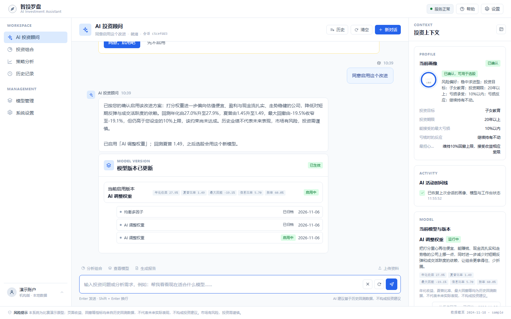
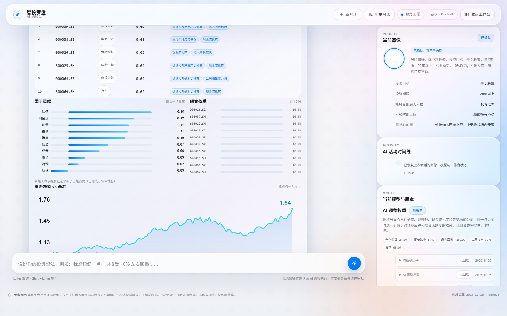
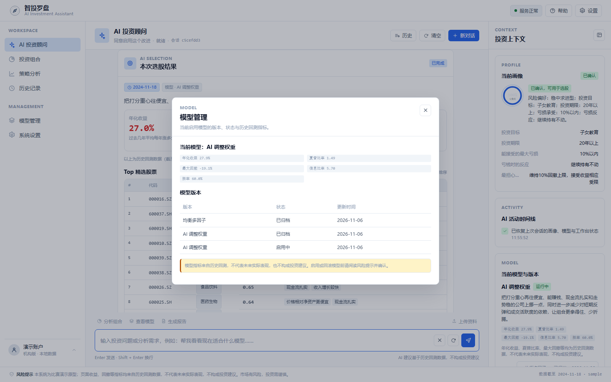
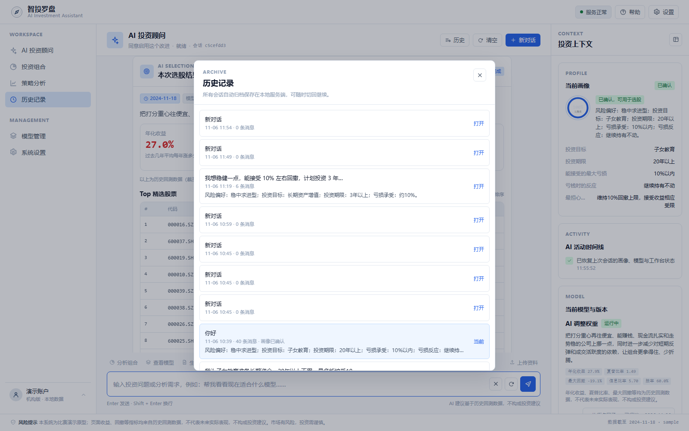
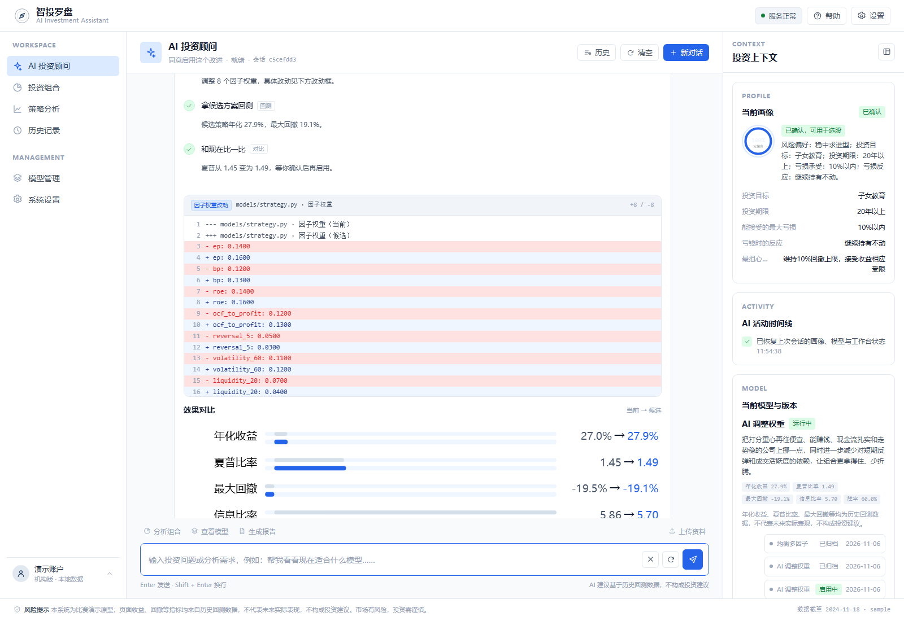
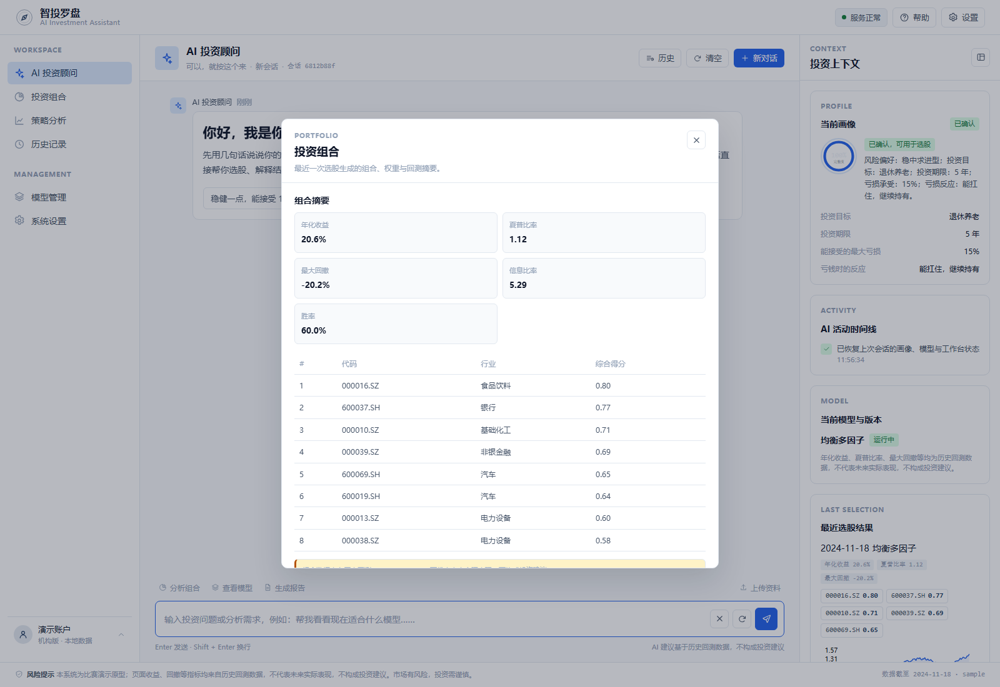
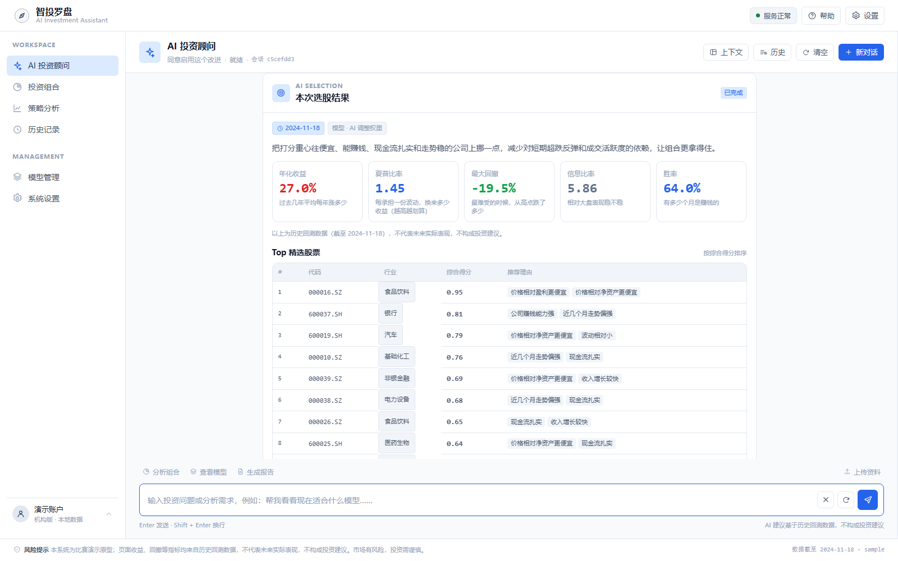
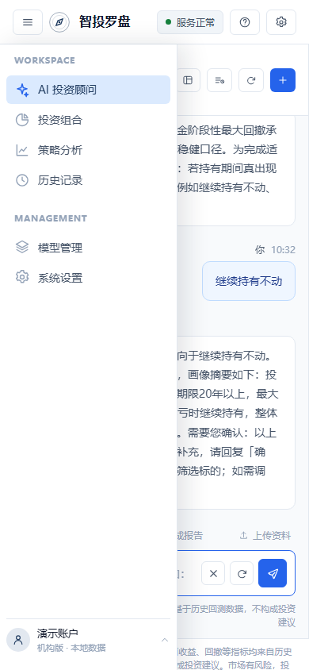
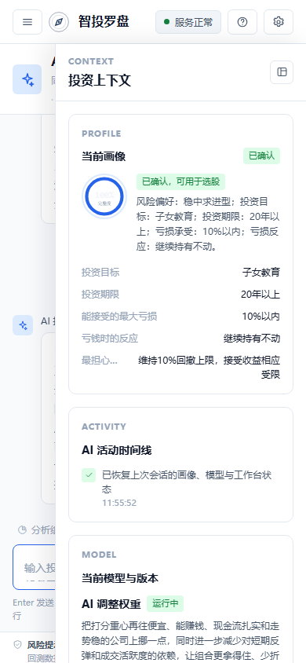
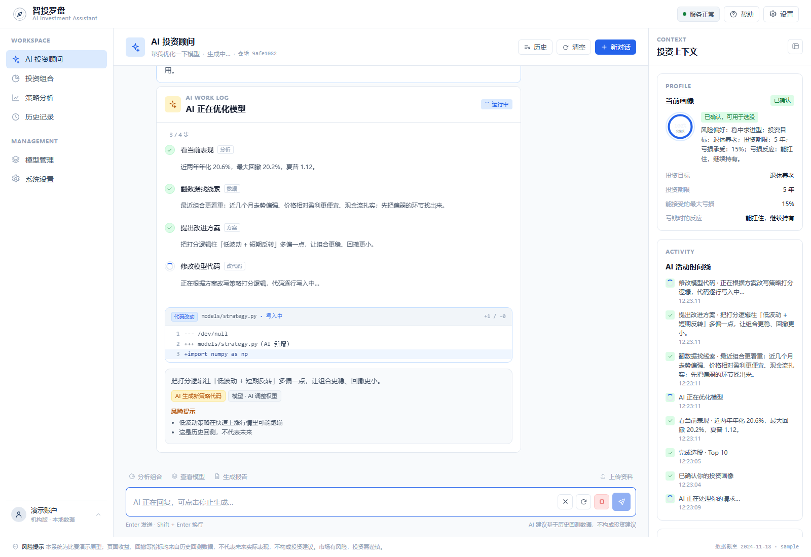

# 智投罗盘 · AI 投资助手（MVP）

一个面向 A 股投资场景的 AI 智能投资顾问：先用自然语言建立投资者画像，再生成适配策略、完成选股与解读，并能分析模型、生成/修改选股代码、回测对比，最后等待用户确认后才启用。

- 前端：原生 JS + 纯 SVG 图表，无构建链、无 CDN；**Professional Financial SaaS** 三栏布局（左侧导航 / 中间 AI 对话工作区 / 右侧投资上下文）
- 后端：FastAPI（单进程同时托管页面与 API）+ SQLite + pandas
- 数据：AkShare 为主、Tushare 为辅；离线缓存自动选择 parquet/CSV；无网络时可用内置示例数据
- 模型：10 因子选股引擎 + 5 种内置模型类型 + AI 按需生成 sklearn 自定义模型 + AI 生成自定义打分代码（AST 白名单 + 子进程冒烟 + 回测验证）

## 它怎么工作

1. **聊天建画像**：AI 用大白话一次问一个问题，自动补齐 12 个画像槽位；信息够了会先复述并请你确认。
2. **AI 主动执行**：你回一句“可以”，AI 自己去确认画像并开始选股（无需点按钮、无需切页面）。
3. **结果与解读**：选股卡展示 Top 10、白话指标、因子贡献、组合权重、净值曲线，并给出基于事实的解读；继续追问即可。
4. **AI 参与建模**：你说“帮我优化模型”，AI 会：
   - 看当前表现 → 翻因子数据找短板 → 提出改进方案（切换内置模型 / 调权重 / 直接生成新的策略代码）
   - 对生成的代码做静态安全检查 + 子进程冒烟 + 全区间回测
   - 把每一步实时展示在聊天里，给出对比指标和风险，**等你明确同意后才启用**，且随时可回滚
5. **版本可回滚**：每次模型变更都落版本（基线 + 候选），聊天里说“回滚到上一个版本”即可。

## 快速开始

```powershell
cd a-share-ai-screener
$py = "C:\Users\77578\.dsh\dsh-runtimes\dsh-primary-runtime\dependencies\python\python.exe"

# 1) 数据缓存（示例数据，离线可用；真实数据用 --source akshare / tushare）
& $py -m backend.data.build_cache --source sample

# 2) 无 Key 本地体验（FakeLLM，仅用于演示与测试）
$env:LLM_PROVIDER = "fake"
& $py -m backend.dev_server --port 8000
# 或正式入口：
# & $py -m uvicorn backend.main:app --port 8000

# 3) 浏览器打开 http://127.0.0.1:8000
```

正式使用需配置真实模型（OpenAI 兼容接口）：

```powershell
pip install -r requirements.txt
$env:DEEPSEEK_API_KEY = "sk-..."
$env:LLM_MODEL = "deepseek-chat"
& $py -m uvicorn backend.main:app --port 8000
```

真实 A 股数据：

```powershell
& $py -m backend.data.build_cache --source akshare --limit 300
# 或 Tushare（需要 TUSHARE_TOKEN）
& $py -m backend.data.build_cache --source tushare --limit 300
```

## 界面

| 三栏工作区（导航 / AI 对话 / 投资上下文） | 选股结果与回测指标 |
|---|---|
|  |  |

| 模型管理（版本与指标） | 历史记录 |
|---|---|
|  |  |

| 代码改动 diff | 投资组合 |
|---|---|
|  |  |

| 收起右侧上下文 | 移动端导航抽屉 |
|---|---|
|  |  |

移动端投资上下文抽屉：



截图来自真实浏览器联调（示例数据 + FakeLLM / 真实 DeepSeek）；真实模型下文字与解读由所选模型生成。

**流式输出**：AI 回复通过 SSE `token` 事件逐字渲染（前端打字机队列）；AI 修改代码/权重/模型类型时，改动框在 `work` 卡片内按行流式写入，`修改模型代码 → 安全检查和回测 → 对比 → 审批` 步骤同步推进：



## 设计系统

- **定位**：Professional Financial SaaS。借鉴 Linear 的极简信息层级、Bloomberg Terminal 的金融数据密度、Stripe Dashboard 的卡片与表格规范；去装饰化，每个视觉元素都有信息功能。
- **布局**：顶部工具栏 56px；左侧导航 224px（<1024px 收为图标，移动端为抽屉）；中间对话区最小 560px；右侧投资上下文 320px（可收起，窄屏为抽屉）；页面边距 24px、栏间距 16px。
- **颜色**：主背景 `#F8FAFC`、卡片 `#FFFFFF`、品牌 Navy `#1E3A5F`、交互蓝 `#2563EB`、辅助蓝 `#DBEAFE`；边框 `#E2E8F0`、强边框 `#CBD5E1`；正文 `#0F172A` / `#475569`，辅助文字 `#94A3B8`。
- **状态与金融语义**：成功 `#15803D` / 警告 `#B45309` / 危险 `#DC2626` / 信息 `#2563EB`；A 股涨跌沿用中国大陆习惯，红色上涨、绿色下跌；所有收益、回撤、夏普等指标旁标注「历史回测数据，不代表未来实际表现」。
- **卡片 / 按钮 / 输入**：卡片白底、1px `#E2E8F0` 边框、10px 圆角、默认无阴影；按钮 6px 圆角、默认 36px 高；输入框 8px 圆角、白色背景、最小 56px，聚焦边框变蓝。
- **字体与数字**：`Inter, PingFang SC, Microsoft YaHei, Noto Sans CJK SC`；金融指标和表格数字使用 `font-variant-numeric: tabular-nums`，避免变化时跳动。
- **克制交互**：页面淡入 150ms、按钮/输入聚焦 120–150ms；不使用动态渐变背景、玻璃拟态、持续发光 AI 图标或无意义悬浮动画；支持 `prefers-reduced-motion`。
- **AI 对话组织**：AI 回复不只输出大段文字，还以指标卡、数据表格、代码 diff、方案对比、风险提示等结构化卡片呈现；审批与启用必须经过聊天确认。
- **换模型与重复提问**：内置 5 种基础风格；客户点名其他模型（SVM、随机森林、梯度提升、聚类等）时，AI 会用 sklearn 写自定义模型代码并回测，不再以“没有对应选项”拒绝。模型收益未达目标时会显式核对并给出「继续优化」选项。确认话术在服务端去重，已确认画像字段不会被重复询问。

## 导航与对话管理

- **左侧导航**：AI 投资顾问、投资组合、策略分析、历史记录、模型管理、系统设置；投资组合 / 策略分析 / 模型管理使用真实会话状态生成只读详情弹窗，不改变后端接口。
- **对话区头部**：显示当前会话名与运行状态；提供历史、清空、新对话；输入区提供分析组合、查看模型、生成报告、上传资料等快捷操作，并支持停止生成、重新生成、清空输入。
- **投资上下文**：自动展示画像、AI 活动、当前模型与版本、最近选股结果；宽屏可收起，窄屏通过「上下文」按钮打开抽屉。
- **历史记录**：按最近更新时间列出全部会话（首条用户消息作为标题、消息数、画像摘要、是否已确认），可切换回任意会话并恢复聊天卡片与代码框。
- 所有会话、画像、模型版本和聊天富卡片都保存在本地 SQLite 中，刷新页面或重启服务不会丢失。

## AI 表达与确认规范

- **金融机构服务口吻**：称呼“您”、结论先行、数据只引用真实回测结果、不做自我叙述（禁止“先问第一个问题/接下来我会”等 AI 套话），风险提示使用“历史业绩不代表未来表现，市场有风险，投资需谨慎”。提示词参考了公募基金销售与投资者适当性管理中的规范话术（见文末参考）。
- **澄清与执行分离**：AI 需要客户补充信息时只提问、本轮不执行任何动作；客户回答后的下一轮才执行。服务端对“边问边改”做硬性拦截，并记录待执行意图（`pending_intent`）。
- **确认话术唯一明确**：画像确认、模型方案审批均使用“需要您确认：……请回复「确认」/「同意启用」/「先不启用」”格式；服务端会兜底补全，避免模型漏说。
- **代码改动可见**：AI 生成/修改策略代码时，聊天内展示 `models/strategy.py` 的行号 diff 代码框，并在审批卡中给出风险与回测对比；富卡片随消息持久化，刷新或重进会话可恢复。

## 代码结构

```
backend/
  main.py            FastAPI：页面 + 聊天 SSE + 状态接口
  dev_server.py      标准库 HTTP 服务（无 fastapi 时本地预览）
  service.py         对话编排：理解 → 回复 → 执行动作 → 生成卡片
  agent.py           Planner 提示词、动作白名单、合规校验
  llm.py             OpenAI 兼容客户端 + FakeLLM（测试/演示）
  schemas.py         画像槽位、计划、白话文案
  store.py           SQLite：会话/消息/画像/模型版本/运行态
  events.py          SSE 格式化
  data/              DataBundle、示例数据、AkShare/Tushare 适配器、缓存 CLI
  engine/            A 股 10 因子、筛选/组合、T+1/涨跌停/停牌/成本回测
  models/            内置模型类型、AI 代码安全校验与编译、提案流水线
frontend/
  index.html / app.js / style.css / charts.js
tests/               98+ 个 unittest（引擎/模型/Agent/存储/对话服务/HTTP）
scripts/             构建缓存、启动、重置、全量测试、E2E 冒烟
docs/                接口契约、运行手册、设计摘要、界面截图
```

## 测试与验收

```powershell
& $py -m unittest discover -s tests -v
$node --check frontend/app.js
$node --check frontend/charts.js
& $py scripts\e2e_smoke.py
```

- 全量测试：引擎、模型安全校验（含拒绝危险代码/死循环超时）、Agent 计划、对话全流程、SQLite、HTTP/SSE
- 浏览器 E2E：真实 Edge 驱动“说话 → AI 追问 → 确认 → 选股 → 优化 → 同意 → 版本更新”全流程；另验证三栏尺寸（56/224/320）、卡片 Token、FakeLLM 对话→画像→选股→刷新恢复、清空对话与移动端抽屉。
- 风险提示：本项目为比赛演示原型，历史回测不代表未来收益，不构成投资建议。

## 参考话术来源（提示词依据）

- 公募基金销售适当性与风险揭示流程话术：[德邦基金公募产品开立交易操作指南](https://www.dbfund.com.cn/upload/pdf/1698046211058-debangjijinguanliyouxiangongsigongmuchanpinkaihujiaoyicaozuozhinan.pdf)
- 理财产品销售告知与期限/风险披露话术：[杭银理财产品话术](http://jsbchina.cn/files/licai/FYG25031A.pdf)
- 高净值客户 KYC 与沟通技巧：[《高净值客户深度 KYC 及沟通技巧》](https://m.jiangshi99.com/course/content/185767.html)
- 证券投资顾问业务与适当性管理要求：[证券投资顾问业务暂行规定](https://www.10jqka.com.cn)
- 财富管理路演支持话术参考：[FinClaw bank wealth-management skill](https://github.com/aifinlab/finclaw/blob/main/skills/bank-t191-wealth-management-roadshow-support-assistant/SKILL.md)

## 设计参考

- [Linear](https://linear.app/)：极简布局、信息层级与克制的交互。
- [Bloomberg Terminal](https://www.bloomberg.com/professional/products/bloomberg-terminal/)：金融数据密度、指标层次与表格表达。
- [Stripe Dashboard](https://stripe.com/docs/dashboard)：卡片、字体、表格与状态设计规范。
