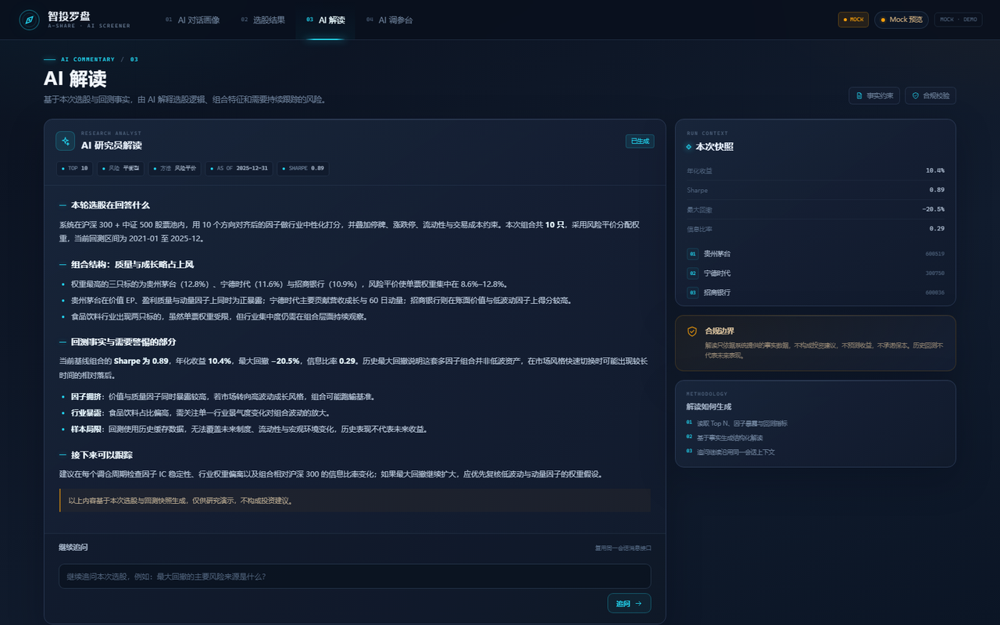
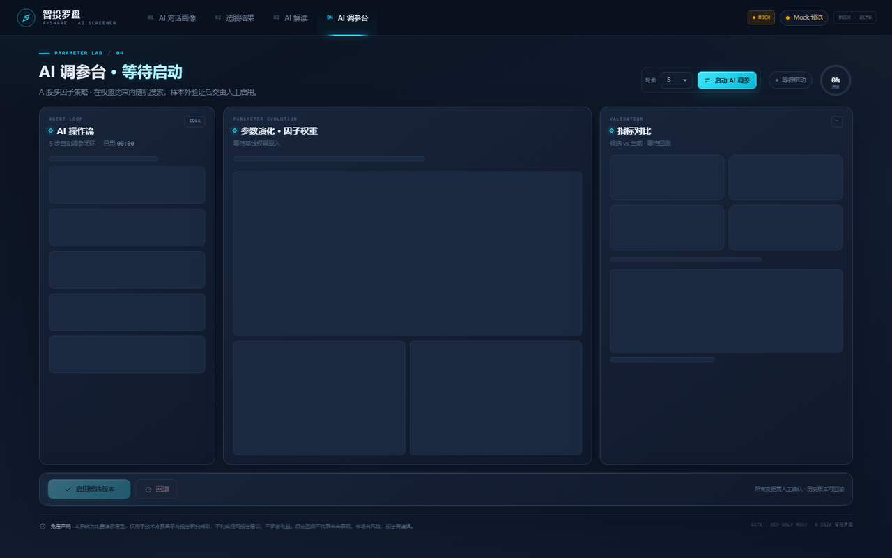

# 智投罗盘 · A 股 AI 选股 MVP

一个 3 天可交付的 A 股 AI 智能选股演示系统：AI 多轮对话建立投资画像 → 按画像适配 10 因子选股 → A 股规则回测 → AI 解读与追问 → AI 参数调优（带可视化调参台与版本回滚）。

- 后端：FastAPI（轻量前后端分离，单进程同时托管页面与 API）+ SQLite + pandas
- 前端：原生 JS + SSE + 纯 SVG/CSS 图表（无构建链、无 CDN 依赖）
- 数据：AkShare 为主、Tushare 为辅；离线缓存（有 pyarrow 时 parquet，否则 CSV）；无网络时可用内置示例数据

## 快速开始

```bash
# 1) 安装依赖
python -m venv .venv
.venv\Scripts\activate        # Windows
pip install -r requirements.txt

# 2) 准备数据（三选一）
python -m backend.data.build_cache --source sample     # 内置示例数据（离线可用）
python -m backend.data.build_cache --source akshare    # AkShare 拉取 A 股真实数据
python -m backend.data.build_cache --source tushare    # Tushare（需 TUSHARE_TOKEN）

# 3) 配置环境变量
set DEEPSEEK_API_KEY=sk-xxx
set LLM_BASE_URL=https://api.deepseek.com/v1
set LLM_MODEL=deepseek-chat

# 4) 启动
uvicorn backend.main:app --port 8000
# 浏览器打开 http://localhost:8000
```

无 FastAPI 环境下可用标准库预览服务器（功能等价，仅开发用）：

```bash
python -m backend.dev_server --port 8000
```

## 目录结构

```
backend/
  main.py            # FastAPI 应用：REST + SSE + 静态托管
  dev_server.py      # 标准库 HTTP 服务器（无 fastapi 时本地预览）
  service.py         # 与框架无关的业务服务层（会话/选股/调优/版本）
  events.py          # SSE 事件总线（channel → 多订阅者队列）
  store.py           # SQLite：sessions/messages/profiles/versions/audit_logs
  agent.py           # LLM 门面：多轮对话、画像抽取、解读、合规校验
  llm.py             # OpenAI 兼容客户端（urllib）+ FakeLLM（测试用）
  schemas.py         # 画像槽位、选股请求、事件负载等数据结构
  engine/
    factors.py       # A 股 10 因子计算 + 行业中性化 + 权重注册表
    selection.py     # 筛选、组合构建、A 股规则回测
    tuner.py         # 因子权重随机搜索（trial 事件回调）
  data/
    base.py          # IDataPort 协议与 DataBundle 数据包
    sample.py        # 合成 A 股示例数据（离线演示）
    akshare_adapter.py
    tushare_adapter.py
    build_cache.py   # 离线缓存构建 CLI
frontend/            # 单页应用：index.html / app.js / charts.js / style.css
tests/               # unittest 测试（引擎/存储/Agent/服务）
docs/                # 设计说明书 PDF、接口契约、设计摘要、图表
data/                # 运行期数据缓存与 SQLite（git 忽略）
```

## 界面预览

| AI 对话画像 | 选股结果 |
|---|---|
|  |  |

| AI 解读 | AI 调参台 |
|---|---|
|  |  |

> 截图说明：对话页截图为连接真实后端（示例数据 + FakeLLM）的状态；其余三张使用 `?mock=1` 开发预览模式填充示例数据（截图右上角有 MOCK 标记）。生产路径不加载任何 mock 数据，真实后端下标的会展示代码+行业，AI 不可用时直接报错而不降级。

## 测试

```bash
python -m unittest discover -s tests -v
node --check frontend/app.js && node --check frontend/charts.js
```

当前状态：30 个测试全部通过；FastAPI 与 dev_server 两种入口均完成 HTTP/SSE 全链路 E2E（对话→画像确认→选股→调参→启用→回滚）。

## 设计文档

- `docs/智投罗盘_A股AI选股_MVP精简设计说明书_v1.2.pdf`（40 页完整设计）
- `docs/CONTRACT.md`（前后端与引擎接口契约，含调参 `compare.nav` 结构）
- `docs/design-summary.md`（关键决策摘要）
- `docs/RUNBOOK.md`（运行手册与排障）

> 免责声明：本项目为比赛演示原型，仅用于技术方案展示与投资研究辅助，不构成任何投资建议，不承诺收益。
