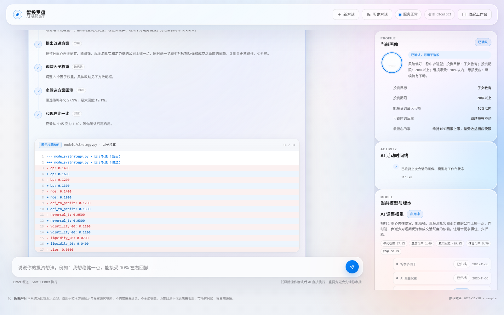
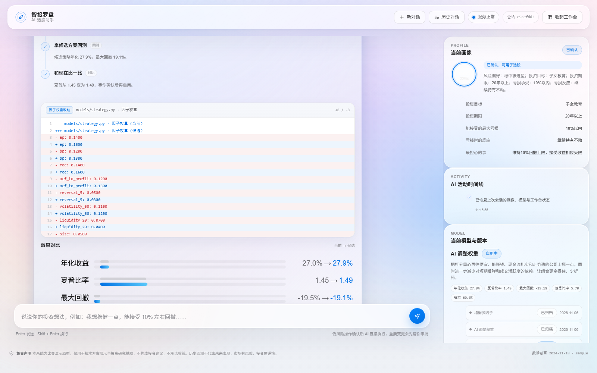
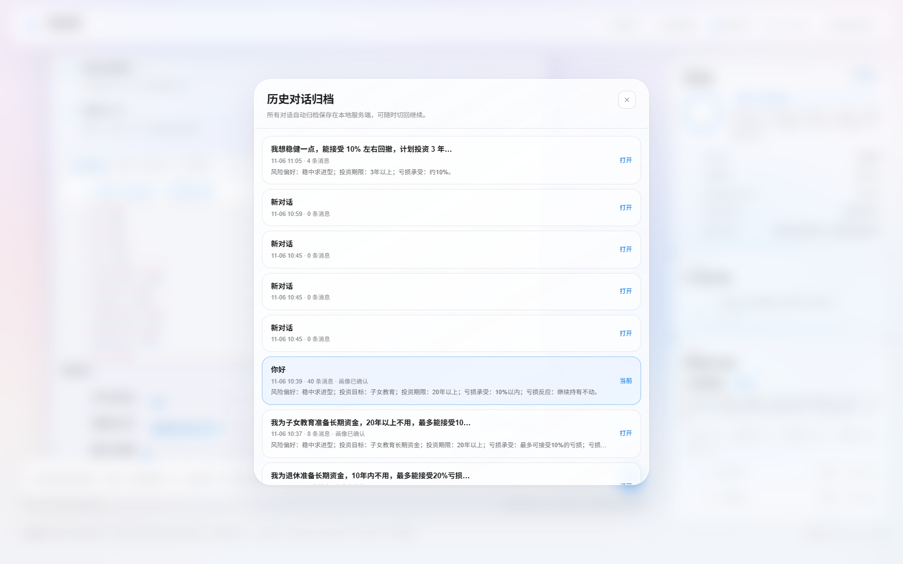
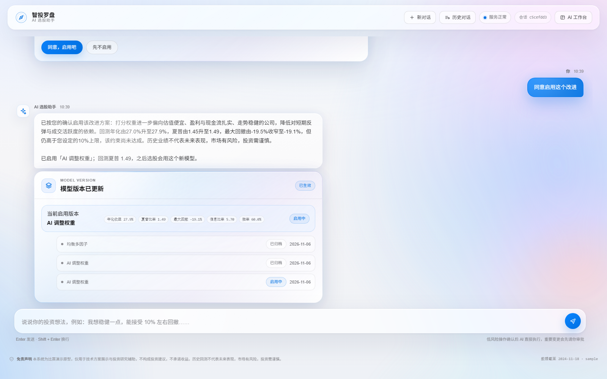
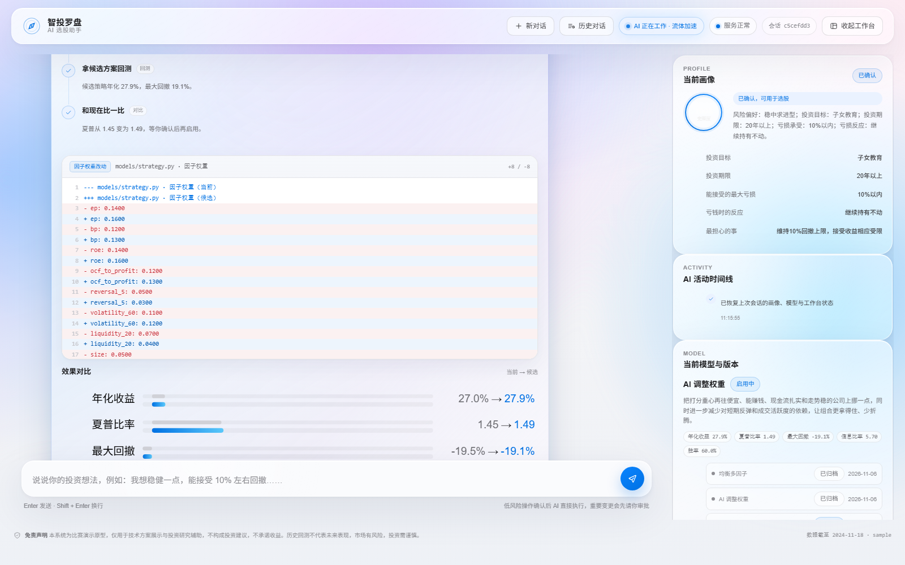

# 智投罗盘 · AI 选股助手（MVP）

一个「只用一个聊天框」完成全部操作的 A 股 AI 选股应用：AI 先像朋友一样了解你，再自动完成选股、解读，并能自己分析模型、生成/修改选股代码、回测对比，最后等你点头后才启用。

- 前端：原生 JS 单页（无构建链、无 CDN、纯 SVG 图表），一个聊天流 + 右侧 AI 工作台
- 后端：FastAPI（单进程同时托管页面与 API）+ SQLite + pandas
- 数据：AkShare 为主、Tushare 为辅；离线缓存自动选择 parquet/CSV；无网络时可用内置示例数据
- 模型：10 因子选股引擎 + 5 种内置模型类型 + AI 生成自定义打分代码（AST 白名单 + 子进程冒烟 + 回测验证）

## 它怎么工作

1. **聊天建画像**：AI 用大白话一次问一个问题，自动补齐 12 个画像槽位；信息够了会先复述并请你确认。
2. **AI 主动执行**：你回一句“可以”，AI 自己去确认画像并开始选股（无需点按钮、无需切页面）。
3. **结果与解读**：选股卡展示 Top 10、白话指标、因子贡献、组合权重、净值曲线，并给出基于事实的解读；继续追问即可。
4. **AI 参与建模**：你说“帮我优化模型”，AI 会：
   - 看当前表现 → 翻因子数据找短板 → 提出改进方案（切换内置模型 / 调权重 / 直接生成新的策略代码）
   - 对生成的代码做静态安全检查 + 子进程冒烟 + 全区间回测
   - 把每一步实时展示在聊天里，给出对比指标和风险，**等你明确同意后才启用**，且随时可回滚
5. **版本可回滚**：每次模型变更都落版本（基线 + 候选），聊天里说“回滚到上一个版本”即可。

## 快速开始

```powershell
cd a-share-ai-screener
$py = "C:\Users\77578\.dsh\dsh-runtimes\dsh-primary-runtime\dependencies\python\python.exe"

# 1) 数据缓存（示例数据，离线可用；真实数据用 --source akshare / tushare）
& $py -m backend.data.build_cache --source sample

# 2) 无 Key 本地体验（FakeLLM，仅用于演示与测试）
$env:LLM_PROVIDER = "fake"
& $py -m backend.dev_server --port 8000
# 或正式入口：
# & $py -m uvicorn backend.main:app --port 8000

# 3) 浏览器打开 http://127.0.0.1:8000
```

正式使用需配置真实模型（OpenAI 兼容接口）：

```powershell
pip install -r requirements.txt
$env:DEEPSEEK_API_KEY = "sk-..."
$env:LLM_MODEL = "deepseek-chat"
& $py -m uvicorn backend.main:app --port 8000
```

真实 A 股数据：

```powershell
& $py -m backend.data.build_cache --source akshare --limit 300
# 或 Tushare（需要 TUSHARE_TOKEN）
& $py -m backend.data.build_cache --source tushare --limit 300
```

## 界面

| 对话建画像 | 选股结果 |
|---|---|
|  |  |

| AI 优化过程（方案/对比/审批） | 模型版本 |
|---|---|
|  |  |

AI 修改策略代码时，聊天内实时展示带行号的代码框（逐行 diff，新增/删除高亮）；消息卡片随对话落库，刷新页面后仍可恢复：




| 历史对话归档 | 收起 AI 工作台 |
|---|---|
|  |  |

截图来自真实浏览器联调（示例数据 + FakeLLM / 真实 DeepSeek）；真实模型下文字与解读由所选模型生成。

AI 工作时，背景流体自动加速、提高饱和度：



## 视觉与交互设计

- **浅色 Apple 风格**：Apple 系统字体栈、浅灰白背景、大圆角、留白与克制的蓝色主色；页面内不使用深色背景。
- **动态流体背景**：Canvas 2D 柔和色团持续流动；AI 处理请求时（`body.ai-working`）速度倍率从 1 平滑升到约 3.6，模糊度降低、饱和度升高，顶栏同时出现「AI 正在工作 · 流体加速」提示，回复结束后回落。
- **沉浸光感卡片**：对话卡片使用真实 `backdrop-filter` 磨砂（blur + saturation + brightness）、层次渐变描边、环境光晕与内层高光；指针经过时，镜面边缘光（Fresnel rim）与内部高光跟随指针移动（由 `--glass-x/--glass-y` 驱动），并根据卡片类型（选股/优化/审批/画像）呈现蓝、紫、暖橙等不同氛围光。
- **光学与无障碍细节**：内容自适应透明度（浅色背景更通透）、柔和彩色投影；支持 `prefers-reduced-motion`（关闭动画）与 `prefers-reduced-transparency`（退化为实色磨砂面板）。
- **绿色使用纪律**：绿色仅用于负向数据（股票/组合下跌、最大回撤等），上涨与正收益使用红系；成功、进行中、普通状态全部使用蓝色或中性灰，避免把绿色当装饰色。
- **新对话与历史归档**：顶栏「新对话」创建会话；「历史对话」打开归档，可切换回任意历史会话并恢复聊天卡片与代码框。

## 对话管理

- 顶栏 **新对话**：立即创建并切换到全新会话；
- 顶栏 **历史对话**：打开归档面板，按最近更新时间列出全部会话（首条用户消息作为标题、消息数、画像摘要、是否已确认），点击任意一条即可切回继续；
- 所有会话、画像、模型版本和聊天富卡片都保存在本地 SQLite 中，刷新页面或重启服务不会丢失；
- AI 工作台支持一键收起，宽屏下对话区自动占满整个宽度。

## AI 表达与确认规范

- **金融机构服务口吻**：称呼“您”、结论先行、数据只引用真实回测结果、不做自我叙述（禁止“先问第一个问题/接下来我会”等 AI 套话），风险提示使用“历史业绩不代表未来表现，市场有风险，投资需谨慎”。提示词参考了公募基金销售与投资者适当性管理中的规范话术（见文末参考）。
- **澄清与执行分离**：AI 需要客户补充信息时只提问、本轮不执行任何动作；客户回答后的下一轮才执行。服务端对“边问边改”做硬性拦截，并记录待执行意图（`pending_intent`）。
- **确认话术唯一明确**：画像确认、模型方案审批均使用“需要您确认：……请回复「确认」/「同意启用」/「先不启用」”格式；服务端会兜底补全，避免模型漏说。
- **代码改动可见**：AI 生成/修改策略代码时，聊天内展示 `models/strategy.py` 的行号 diff 代码框，并在审批卡中给出风险与回测对比；富卡片随消息持久化，刷新或重进会话可恢复。

## 代码结构

```
backend/
  main.py            FastAPI：页面 + 聊天 SSE + 状态接口
  dev_server.py      标准库 HTTP 服务（无 fastapi 时本地预览）
  service.py         对话编排：理解 → 回复 → 执行动作 → 生成卡片
  agent.py           Planner 提示词、动作白名单、合规校验
  llm.py             OpenAI 兼容客户端 + FakeLLM（测试/演示）
  schemas.py         画像槽位、计划、白话文案
  store.py           SQLite：会话/消息/画像/模型版本/运行态
  events.py          SSE 格式化
  data/              DataBundle、示例数据、AkShare/Tushare 适配器、缓存 CLI
  engine/            A 股 10 因子、筛选/组合、T+1/涨跌停/停牌/成本回测
  models/            内置模型类型、AI 代码安全校验与编译、提案流水线
frontend/
  index.html / app.js / style.css / charts.js / fluid.js
tests/               95+ 个 unittest（引擎/模型/Agent/存储/对话服务/HTTP）
scripts/             构建缓存、启动、重置、全量测试、E2E 冒烟
docs/                接口契约、运行手册、设计摘要、界面截图
```

## 测试与验收

```powershell
& $py -m unittest discover -s tests -v
$node --check frontend/app.js; $node --check frontend/charts.js
& $py scripts\e2e_smoke.py
```

- 全量测试：引擎、模型安全校验（含拒绝危险代码/死循环超时）、Agent 计划、对话全流程、SQLite、HTTP/SSE
- 浏览器 E2E：真实 Edge 驱动“说话 → AI 追问 → 确认 → 选股 → 优化 → 同意 → 版本更新”全流程
- 风险提示：本项目为比赛演示原型，历史回测不代表未来收益，不构成投资建议。

## 参考话术来源（提示词依据）

- 公募基金销售适当性与风险揭示流程话术：[德邦基金公募产品开立交易操作指南](https://www.dbfund.com.cn/upload/pdf/1698046211058-debangjijinguanliyouxiangongsigongmuchanpinkaihujiaoyicaozuozhinan.pdf)
- 理财产品销售告知与期限/风险披露话术：[杭银理财产品话术](http://jsbchina.cn/files/licai/FYG25031A.pdf)
- 高净值客户 KYC 与沟通技巧：[《高净值客户深度 KYC 及沟通技巧》](https://m.jiangshi99.com/course/content/185767.html)
- 证券投资顾问业务与适当性管理要求：[证券投资顾问业务暂行规定](https://www.10jqka.com.cn)
- 财富管理路演支持话术参考：[FinClaw bank wealth-management skill](https://github.com/aifinlab/finclaw/blob/main/skills/bank-t191-wealth-management-roadshow-support-assistant/SKILL.md)

## 视觉设计参考

- 沉浸光感材质（华为开发者问答）：[沉浸光感材质在卡片中如何使用](https://developer.huawei.com/consumer/cn/forum/topic/0207211216415627050?fid=0109140870620153026)、[接入沉浸光感后如何增强效果](https://developer.huawei.com/consumer/cn/forum/topic/0202219337594255098?fid=0101587865002800104)
- Apple Liquid Glass 设计语言：[Apple 新软件设计新闻稿](https://www.apple.com.cn/newsroom/2025/06/apple-introduces-a-delightful-and-elegant-new-software-design/)、[WWDC25 Liquid Glass 介绍](https://developer.apple.com/la/videos/play/wwdc2025/219/)
- 玻璃材质的光学实现参考（磨砂、镜面高光锐度、内容自适应强度、无障碍回退）：[liquid_glass_widgets 文档](https://pub.dev/packages/liquid_glass_widgets/versions/0.17.1)
